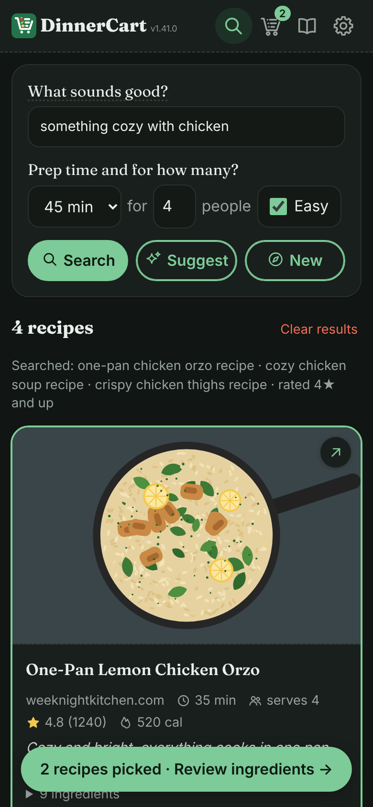
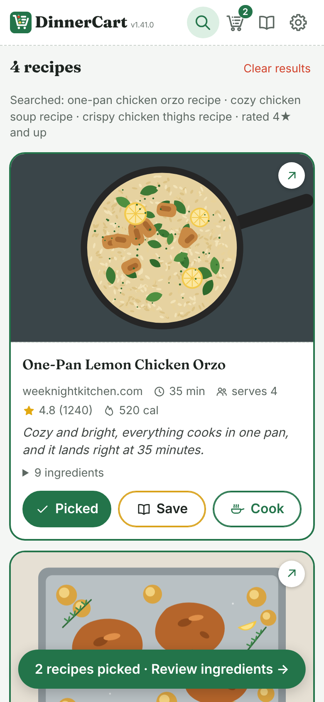
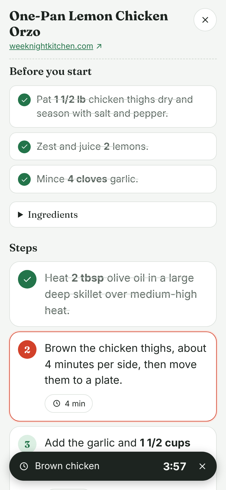
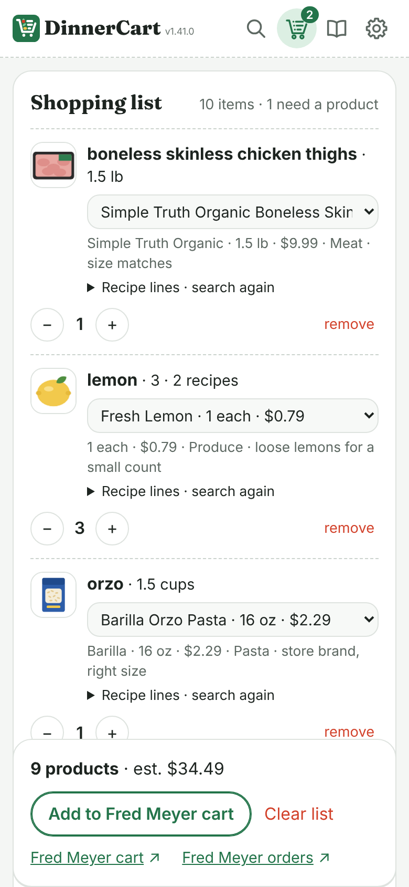

# DinnerCart


A personal web app for our household: describe what you feel like eating, get
free recipes from the web, pick a few, and DinnerCart matches the ingredients
to Fred Meyer products and adds them to our shared Fred Meyer cart. Checkout
happens in the Fred Meyer app. When it's time to cook, **Cook** turns any
recipe into easy, scaled, step-by-step instructions with timers.

- App: <https://jarretmorton.github.io/DinnerCart/>
- Relay: `https://dinnercart-relay.jarret-morton.workers.dev`

Want it for your household? Each household runs its own copy: its own site,
relay, Fred Meyer login, shared recipes and password. It's all free tiers.
See [Run your own DinnerCart](#run-your-own-dinnercart).

<p>
  
  
  
  
</p>

<sub>Search (night mode), a recipe card, Cook, and the matched shopping list.
Sample data; the food pictures are illustrations standing in for recipe and
product photos. Retake them with `docs/screenshots/make/take.mjs`.</sub>

```
 Browser (GitHub Pages, /web)                     Cloudflare Worker (/relay)
 ───────────────────────────                      ──────────────────────────
 criteria ─► Gemini: 3 search queries
          ─────────────────────────────────────► /search  ─► Brave Search
          ─────────────────────────────────────► /recipe  ─► recipe page → JSON-LD
 filter (time, rating, leave-out, Easy)                      (cached in KV)
          ─► Gemini: rank, user picks
 ingredients ─► Gemini: normalize lines
          ─► Kroger API, straight from the phone (search-only token from /kroger/token)
             or, if that fails ────────────────► /kroger/products ─► Kroger API
          ─► Gemini: choose product + count
 review screen (swap / remove / qty)
          ─────────────────────────────────────► /kroger/cart ─► PUT /cart/add
 Cook: the page's own steps ─► Gemini: easy steps, checked
          ─────────────────────────────────────► /library (kept with saved recipes)
```

The relay exists because browsers can't call Brave or recipe sites directly
(CORS), and the Kroger client secret can't live in a public web page. Every
relay request needs the relay password in the `X-Relay-Password` header. The
only exception is the Kroger OAuth callback, which is authenticated by a
single-use `state` value.

## Repository layout

| Path | What |
|---|---|
| `web/` | The static site. Plain HTML and ES modules, no build step. |
| `web/js/app.js` | UI controller: views, events, settings. |
| `web/js/resolver.js` | Ingredient resolver (normalize → pantry → merge → search → pick → package count). Shared with the eval. |
| `web/js/units.js` | Unit conversion and Kroger size parsing (`"6 ct / 12 fl oz"`, `"1/2 gal"`…). |
| `web/js/recipes.js` | Query generation (Search, Suggest and New), structured filters, Gemini ranking. |
| `web/js/gemini.js` | Gemini client with the strong → light fallback. |
| `web/js/suggestions.js` | Rotating "What sounds good?" ideas and the daily Gemini batch. |
| `web/js/cook.js`, `web/js/cook-view.js` | Cook: easy steps written by Gemini from the recipe's own method, amount scaling, and the Cook screen (ticks, timers, screen stays on). |
| `web/js/library.js` | Save tab grouping (This week / Last week / Last 30 days / Older). |
| `web/js/config.js` | The relay URL, filled in at deploy from the `RELAY_URL` repository variable. |
| `web/js/setup-link.js` | The "Share setup link" that sets up another phone in one tap. |
| `web/js/kroger.js`, `web/js/kroger-shared.js` | Direct-from-browser product search with relay fallback; product formatting shared with the relay. |
| `web/js/icons.js` | The app's line icons. |
| `web/js/version.js` | App version shown in the header. |
| `web/styles.css`, `web/fonts/` | Design tokens and styles (light and night), self-hosted fonts. |
| `scripts/stamp-site.mjs` | Adds a per-deploy `?v=` to every script and stylesheet so browsers never mix old and new files, and builds in the relay URL. |
| `relay/` | The Cloudflare Worker: Brave proxy, JSON-LD extraction, Kroger OAuth/products/cart, recipe library, shared prefs. |
| `eval/` | 50 real recipe lines, each with the product it should match, plus the scoring script. |
| `test/`, `relay/test/` | Unit tests (`npm test`, no dependencies). |
| `docs/build-plan.md` | The original build plan. |
| `docs/screenshots/` | README screenshots; `make/take.mjs` retakes them against sample data. |
| `CLAUDE.md` | Working rules for Claude Code: version bumps, design language, checks before pushing. |

## Run your own DinnerCart

One person per household does this once, in about 30–45 minutes. Nothing in
the code needs editing: the site and relay work out their addresses from your
GitHub account and repository name.

### 0. Fork

Fork this repository on GitHub (or copy it into a new repository). Keep the
name `DinnerCart` or pick your own. The site will live at
`https://<your-github-name>.github.io/<repo-name>/`.

Then do these in order. Each step tells you what to save; the GitHub settings
table in step 4 collects them all.

### 1. Kroger developer app (do this first; it's the riskiest part)

1. Sign up at <https://developer.kroger.com> and create an application in the **Production** environment.
2. API products: **Cart**, **Locations**, **Products** (scopes `cart.basic:write` and `product.compact`). Profile isn't needed.
3. Redirect URI: `https://dinnercart-relay.<your-subdomain>.workers.dev/kroger/oauth/callback`.
   You'll know the exact Worker URL after the first deploy (step 4). You can edit the URI later.
4. Save the **client ID** and **client secret**.

### 2. Brave Search API

Create an account at <https://api-dashboard.search.brave.com>, subscribe to
the free/credit Search plan (check the current terms; at the time of the plan
new accounts got about $5/month of credit, roughly 1,000 queries), and save the
**API key**. Each recipe search uses up to 3 queries. Results are cached in KV
for 7 days, so repeat searches are free.

### 3. Cloudflare

1. Create a free Cloudflare account.
2. Go to **Storage & Databases → KV → Create namespace**, name it `dinnercart`, and save its **namespace ID**.
3. Go to **My Profile → API Tokens → Create Token → "Edit Cloudflare Workers"** template, and save the **token**.
4. Save your **account ID** (shown on the Workers & Pages overview page).

### 4. GitHub repository settings

**Settings → Secrets and variables → Actions**:

| Kind | Name | Value |
|---|---|---|
| Secret | `CLOUDFLARE_API_TOKEN` | from step 3 |
| Secret | `CLOUDFLARE_ACCOUNT_ID` | from step 3 |
| Secret | `BRAVE_API_KEY` | from step 2 |
| Secret | `KROGER_CLIENT_ID` | from step 1 |
| Secret | `KROGER_CLIENT_SECRET` | from step 1 |
| Secret | `RELAY_PASSWORD` | a long random string, e.g. `openssl rand -base64 24` |
| Secret | `GEMINI_API_KEY` | optional, for the eval workflow (step 5) |
| Variable | `KV_NAMESPACE_ID` | from step 3 (a secret works too) |
| Variable | `RELAY_URL` | the Worker URL, after the first deploy. Built into the site so nobody has to type it; also used by the eval workflow |
| Variable | `APP_URL` | optional: only if the site isn't at your GitHub Pages address (e.g. a custom domain) |

Also in repository **Settings**:
- **General → Default branch:** `main`. The deploy workflows run on pushes to `main`.
- **Pages → Build and deployment → Source:** GitHub Actions.
- **Environments → `github-pages` → Deployment branches:** must allow `main`. GitHub creates this rule for whichever branch was the default when Pages was turned on.

Push to `main`, or run both workflows from the **Actions** tab. The *Deploy
relay* workflow publishes the Worker, pushes the four Worker secrets, and
points the relay at your site (`https://<owner>.github.io/<repo>/`, or
`APP_URL`). The relay only answers browsers from that site and
`http://localhost:8080`. The *Deploy site* workflow publishes `web/` to your
GitHub Pages address.

The first relay deploy prints the Worker URL. Save it as the `RELAY_URL`
variable, add its `/kroger/oauth/callback` to the Kroger app (step 1), then
run *Deploy site* again from the Actions tab so the site picks it up. After
that, every push to `main` deploys whatever changed.

### 5. Gemini key (each person, on each device)

Get a free key at <https://aistudio.google.com/apikey>. The free tier may use
prompts for training, which is fine for this app. The key is pasted into the
app's Config tab and stored only in that browser's localStorage.

### 6. In the app

1. Open the site → **Config**. Enter the relay password and Gemini key, then **Save**. The relay URL is already built in (leave it blank) if you set `RELAY_URL`.
2. Press **Check setup**. It checks the relay, the Worker secrets, Gemini, and whether Kroger allows direct browser calls (CORS).
3. Under **Household (shared)**, press **Connect Fred Meyer** and log in once. The refresh token is stored in Workers KV and shared by both of you.
4. Enter your ZIP → **Find stores** → choose your Fred Meyer, and choose pickup or delivery.
5. Set the search defaults (max time, servings, minimum rating), your "what to leave out" list, your shopping preferences (optional, see *Pick and send*), and the pantry staples list. Pantry items are never added to the cart.

Everything under Household is saved on the relay, so both of you share it. The relay URL, password and Gemini key are per device.

### 7. The rest of the household

On a phone that's set up, go to **Config → Share setup link** and send it
to the other phone (it uses the share sheet, or copies the link). Opening it
saves the relay password, plus your Gemini key if you ticked **Include my
Gemini key**, on that phone. Otherwise they add their own key, so each person
uses their own free Gemini quota. The settings travel in the part of the
link after `#`, which browsers never send to any server. The link does carry
the relay password, so only send it within your household.

### 8. Put it on the home screen

Add the site to each phone's home screen (Safari: Share → **Add to Home
Screen**; Chrome on Android: ⋮ → **Add to Home screen** or **Install app**).
It then opens as its own app, on Search, instead of a new browser tab each
time. If an icon was added before version 1.30, remove it and add it again.

On an iPhone the home-screen app keeps its own storage, apart from Safari, so
it starts at Config the first time. Tap **Paste it here** (under This device)
and paste a setup link from **Share setup link**, or type the settings in.

## Using it

Four tabs: **Search**, **Pick** (this shop's recipes and shopping list),
**Save** (your shared recipes) and **Config**. On narrow screens the tabs show
icons only. The app opens on Search (Config until it's set up); a reload
stays on the tab you were on.

**Buttons:** green moves you forward (Search, Pick, Cook, Match, Add to
Fred Meyer cart); lemon keeps (Save on a recipe, the Config Saves); red
discards (Remove, Disconnect). All start outlined and go solid once they're done or in effect: the
search method behind the results, a picked or saved recipe, Cook when its
steps are already written, Match while the list fits the picks, Add to Fred
Meyer cart until the list changes. Plain red text clears (Clear results,
Clear picks, Clear list, remove). Links are green. Lemon also marks things
worth noticing: the "your usual" and "sale" tags on the shopping list, and
rating stars. Buttons go solid as soon
as you tap them (the other search buttons go back to outlines), and turn back
to an outline if you cancel or it fails.

### Search

- **What sounds good?** Describe it in your own words. The box rotates ideas
  that Gemini writes fresh once a day (light model, using the season and your
  saved recipes; shared by both of you; a built-in list fills the gap). Tap
  the label to use the idea showing.
- **Prep time and for how many?** 15 min to 1 hour, or any; servings; and the **Easy** checkbox next to them.
- **Easy** (a setting, so it's a checkbox like the Config one, not a button): low-effort dinners. At most
  10 ingredients (pantry staples don't count) and 8 steps, both adjustable in
  Config, with searches and ranking steered toward simple, one-pan dishes.
  It's separate from time, so an easy one-hour roast still counts. It applies
  to Search, Suggest and New alike, and Config can turn it on by default.
- **Search** finds recipes for what you typed. **Suggest** (green) needs
  nothing filled in: Gemini looks at your saved recipes (plus anything you
  typed) and finds new dishes in a similar vein, skipping ones you've already
  saved. **New** (compass) is the opposite: it reads your saved recipes to see
  what you usually cook, then looks for something different (other cuisines,
  main ingredients and cooking styles), still within anything you typed. With
  nothing saved yet, it picks a mix of cuisines.
- Every search skips recipes with anything on the household **what to leave
  out** list (Config), rated below the household minimum (Config, default 4★;
  unrated ones are kept), over the time, or over the Easy limits. Skipped
  recipes and pages that couldn't be read are listed with the reason.
  **Clear results** empties the list. The button used for the results below
  stays solid.

Every recipe card has **Pick** (for this shop), **Save** and **Cook**. A
picked card gets a green outline. Tap the photo (it has a ↗ badge) to open
the original recipe page.

### Save

One shared list of everything saved, by hand or automatically when sent to
Fred Meyer, grouped into **This week** (weeks start Monday), **Last week**,
**Last 30 days** and **Older** by when it was last saved or picked. Filter it,
**Pick** a recipe again, **Cook** it, or **Remove** it (it fills red while it
asks to confirm). Add any recipe by
pasting its link at the bottom.

Give each saved recipe a **family rating**: tap the happy (*Loved it*), meh
(*It was OK*) or sad (*Not again*) face on its card, and tap it again to
clear it. It's one rating for the household, shared by both phones, and it
shows on the recipe in Search results too. **Suggest** leans toward dishes
like the ones you loved and steers clear of anything like the ones you didn't.

### Cook

- Gemini rewrites the recipe page's own steps into one action per step, plus
  a **Before you start** list (preheat, prep pans, chop and measure). Every
  temperature, time and amount stays as the original gives it. Cook always
  uses the strong model (the light one only if the strong one is rate limited).
- **Checked:** every ingredient on the list has to be named in the steps. If
  Gemini leaves one out, the app asks once more; anything still missing, or a
  temperature from the original that didn't make it in, is flagged at the top.
  The original recipe is linked at the top too.
- Amounts scale to the number of people (your picked servings, the search's,
  or the household default; change it with − / +), in the steps, the prep list
  and the ingredients.
- Tap a line to tick it off; the next step is outlined. Steps with a wait
  (bake, simmer, rest) have a timer button; timers ring, vibrate and stay on
  screen even if you close Cook. The screen stays on while Cook is open, and
  Back closes it.
- **Regenerate cook steps** writes new ones and replaces the saved ones;
  **Start cook over** unticks everything.
- Steps are written once and kept on the phone. Saving a recipe (by hand or by
  sending it to Fred Meyer) stores its steps in the shared Save list, so both
  of you get them without asking Gemini again.

### Pick and send

1. Adjust servings per recipe (quantities scale), then press **Match
   ingredients**. **Clear picks** empties the picks and the shopping list in
   the app; **Clear list** (next to the send button) empties just the list.
   Neither touches the Fred Meyer cart.
2. Review each line: swap to another candidate, search again, change the
   count, or remove it. Pantry staples, optional garnishes and water are listed
   under *Not adding*; tap + to add one anyway. If a Fred Meyer search fails,
   the line says why.

   Each line's note says why that product was chosen.
   - **Shopping preferences** (Config → Shopping): plain lines like "organic
     produce and dairy", "Tillamook cheese", "2% milk", "no store-brand
     coffee". Match follows them when it chooses products, and for items a
     preference covers it also searches for that version ("organic baby
     spinach") so there's one to choose. What the recipe asks for still comes
     first: a recipe's whole milk stays whole milk.
   - **Usual products:** the product you swap to becomes the household's usual
     for that item, shared by both phones. Next time Match looks it up, puts it
     first and picks it (marked *your usual*) unless it's wrong for the recipe;
     if the store doesn't carry it, the line says so. Config → Shopping lists
     them, with a trash button to forget one.
3. Press **Add to Fred Meyer cart**, then use the **Fred Meyer cart** link
   below it to review and check out, and **Fred Meyer orders** to see past and
   current orders (Kroger's API can't read orders, so this opens Fred Meyer's
   purchases page). On phones these usually open the Fred Meyer app. The
   recipes you sent are saved to the **Save** tab automatically.

The Kroger cart API is **write-only**: DinnerCart can add items but can't see
or remove them. If you press *Send again*, the items are added a second time,
and the app asks you to confirm first.

## Development

The app version lives in `web/js/version.js` and shows in the header. Bump it with every change so you can tell whether a browser has the latest build. GitHub Pages can cache the page for up to 10 minutes. The deploy stamps every file with the commit, so a page always loads code from its own deploy.

The design language ("Tomato & Basil", with a matching night mode) and the icon rules are written down in `CLAUDE.md`.

```sh
npm test                      # unit tests: relay, resolver, recipes, Cook, units, eval scoring
npm run serve                 # site at http://localhost:8080 (already in ALLOWED_ORIGINS)

cd relay && npm install
cp .dev.vars.example .dev.vars   # fill in keys for local dev
npm run dev                   # Worker at http://localhost:8787 with local KV
```

Point the app's relay URL at `http://localhost:8787` for local testing. For
Kroger OAuth locally, also add `http://localhost:8787/kroger/oauth/callback` as
a redirect URI on the Kroger app.

### Resolver eval

`eval/cases.json` has 50 real recipe lines. Each one names the product it
should resolve to, by required and banned description words (for example,
"onion" but not "powder"/"red"/"green"), or by exact accepted UPCs once you've
confirmed them at your store. Some cases also give the expected package count.

```sh
GEMINI_API_KEY=... RELAY_URL=https://dinnercart-relay.<sub>.workers.dev RELAY_PASSWORD=... npm run eval
npm run eval -- --verbose       # print every case
npm run eval -- --only=3,17     # subset
npm run eval -- --no-cache      # re-query Kroger (otherwise eval/.cache is reused)
npm run eval -- --min=0.85      # fail below 85% product accuracy
```

It reports **product accuracy**, **search recall** (whether any correct product
was in the search results at all, which separates search misses from pick
misses), and **package-count accuracy**. Full results are written to
`eval/results/latest.json`. Run it after every resolver or prompt change. The
*Resolver eval* workflow also runs it on pushes to `main` that touch the
resolver, once the secrets are set. Those runs use the light model
(`gemini-flash-lite-latest`), so they don't spend the strong model's small free
daily allowance (each run takes about 7 requests, and the limit is counted per
model). To score the strong model, run the workflow by hand from the Actions
tab and choose `gemini-flash-latest`. A failed run shows as failed, with the
error in the run's summary. Locally, set `GEMINI_MODEL` to pick the model.

To lock a case to the exact product, add `"upcs": ["0001111041700"]` to its
`expect`.

## Relay API

All routes need `X-Relay-Password`, except the OAuth callback.

| Route | Body / query | Returns |
|---|---|---|
| `GET /health` | | which secrets/bindings are configured |
| `POST /search` | `{queries: [..≤5]}` | merged, de-duplicated Brave results |
| `POST /recipe` | `{url, refresh?}` | `{recipe}` parsed from JSON-LD (including the original `instructions`, for Cook), or `{recipe: null, reason}` |
| `POST /kroger/products` | `{terms: [..≤20], locationId}` | `{results: {term: [product]}, errors: {term: message}}` |
| `GET /kroger/locations` | `?zip=97214` | Fred Meyer stores within 25 miles (all Kroger-family stores if there are none) |
| `POST /kroger/cart` | `{items: [{upc, quantity}], modality}` | `{added, batches}` (batches of 25) |
| `GET /kroger/status` | | `{connected, connectedAt}` |
| `GET /kroger/token` | | short-lived search-only token (`product.compact`, no cart access) so the browser can search Kroger directly |
| `POST /kroger/oauth/start` | `{returnTo}` | `{url}` to send the browser to |
| `GET /kroger/oauth/callback` | (from Kroger) | redirects back to the app |
| `POST /kroger/disconnect` | | forgets the stored tokens |
| `GET/POST/DELETE /library` | `{recipe}` / `?id=` | shared recipe library (`savedAt`, `lastPickedAt`, `pickedCount` and Cook steps per recipe) |
| `POST /library/picked` | `{recipes: [..≤20]}` | saves recipes just sent to the cart and records the pick; returns the library |
| `POST /library/rating` | `{id, rating}` (`happy`, `meh`, `sad` or `null`) | sets or clears a saved recipe's family rating (`familyRating`, `ratedAt`) |
| `GET/PUT /prefs` | `{prefs: {store, pantry, leaveOut, shoppingPrefs, modality, minRating, maxMinutes, servings, easy, easyMaxIngredients, easyMaxSteps, dailyIdeas}}` | shared household settings |
| `GET /usuals` | | `{usuals: {item name: {upc, description, brand, size, image, at}}}` |
| `PUT /usuals` | `{key, product}` (`product: null` forgets it) | sets one item's usual product (keeps the latest 300) |

The library stores each recipe's URL, ingredients and metadata, plus the
app's own rewritten Cook steps once someone has opened Cook. It never stores
the original page's instructions, and always links to the source page.

## Known constraints

- The Kroger cart is write-only (see above). It allows about 5,000 cart calls per day, and DinnerCart uses one call per 25 items.
- Kroger's API sits behind a bot firewall that sometimes blocks Cloudflare's shared servers ("403 Access Denied"). So the app searches products and looks up stores **directly from the phone**, using a search-only token from the relay in the web address (Kroger allows browser requests, but refuses the CORS preflight a header would need), and falls back to the relay (per item for products) if that fails. **Check setup** shows which path is working and, if direct search fails, why. Relay requests identify the app, run 2 product searches at a time, retry once after a firewall block and then stop for that request, and cache product results for 6 hours.
- Pages that block bots or have no `schema.org/Recipe` markup are skipped. They're listed under "couldn't be read" with the reason.
- Free Cloudflare Workers get 10 ms of CPU per request. That's why each recipe page is parsed in its own request.
- Cook needs the recipe page to publish its steps in `schema.org/Recipe` markup; pages that don't just link to the original. Gemini's rewrite is checked for missing ingredients and temperatures, but it can still get something wrong, so glance at the original for anything critical.
- The Gemini free tier is rate-limited, and tightly: the strong model (`gemini-flash-latest`) can allow as few as 20 requests a day. A search uses about 2, Match 2 to 3, Cook 1 to 2. Each visit starts on the strong model. When it hits its limit, shows no sign of life within 30 seconds or isn't done within a minute (the same for Search, Match and Cook; Light, with nothing to switch to, gets the whole minute; requests are regular one-piece ones: streaming was tried and came out about 10 s slower on the phone), or is overloaded, the app switches to the light model (`gemini-flash-lite-latest`) until you reload; when it's the daily limit, every visit starts on Light until the limit resets (midnight Pacific). The Strong (anvil) / Light (feather) toggle in Config shows which model is active and can be switched by hand. Config → Check setup shows how long Gemini takes on this device; Config → Test Gemini speed (separate, since it's slow) compares a streamed and a regular request and times the same one-line test on a few other Flash-Lite and Flash models the key can use. Errors say what happened in plain words (daily limit used up and when it resets, no answer in time, bad key, offline). Adding billing to the Gemini key raises the limits.

## Credits

- Fonts: [Fraunces](https://github.com/undercasetype/Fraunces) and [Inter](https://github.com/rsms/inter), both under the SIL Open Font License, self-hosted in `web/fonts/`.
- Icons: drawn for DinnerCart, except the feather (Light model) and the three family-rating faces (mood-happy, mood-empty, mood-sad), which are from [Tabler Icons](https://tabler.io/icons) (MIT License, © 2020-2024 Paweł Kuna).

## Build plan status

- [x] Kroger: OAuth (authorization code + refresh), product search, location search, batched cart add through the relay. Finding: Kroger *does* allow browser CORS (a direct call returns HTTP 401, not a CORS error), but the relay is still required because the client secret and the user tokens must not live in the browser.
- [x] Ingredient resolver + 50-line eval set + scoring script.
- [x] Recipe search: Brave + JSON-LD extraction in the Worker.
- [x] UI: criteria, results, review screen, settings (Gemini key, relay password, store, pantry), plus Suggest, New, daily ideas and the Tomato & Basil design.
- [x] Saved recipe library, plus KV caching of parsed recipes and search results.

Added since: Cook (easy, scaled, checked steps with timers), the Easy filter,
Suggest, New and daily ideas, direct-from-phone product and store search,
shopping preferences and usual products, the Fred Meyer cart and orders links,
the one-tap setup link, and deploys that work for any fork.

Out of scope for the MVP: meal planning, price/coupon optimization, nutrition
tracking, learning from past orders (beyond the usual products you pick). One relay serves one household; other
households run their own copy (see above).
